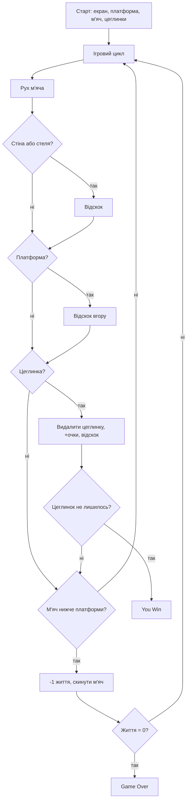

# Day 87 — Breakout

**Час:** ~120 хвилин
**Гра:** https://elgoog.im/breakout/
**Довідка:** https://en.wikipedia.org/wiki/Breakout_(video_game)
**Основа:** уроки Day 22 (гра Pong на `turtle`)

## Мета

Зробити гру Breakout: м'яч і платформа (paddle) руйнують стіну з цеглинок.
Не дивитися туториали «як зробити Breakout». Спершу розписати проєкт, потім розбиратися самостійно.

## Правила гри

1. Платформа внизу екрана рухається вліво/вправо.
2. М'яч відбивається від стін, стелі та платформи.
3. Влучання в цеглинку знищує її, м'яч відскакує.
4. Якщо м'яч впав нижче платформи, гравець втрачає життя.
5. Перемога: усі цеглинки знищені. Поразка: життя закінчились.

## Структура файлів

```
Day_87/
├── main.py        # екран, ігровий цикл
├── paddle.py      # клас Paddle
├── ball.py        # клас Ball
├── bricks.py      # клас Bricks (стіна з цеглинок)
└── scoreboard.py  # рахунок, життя, повідомлення
```

## Чекліст

### 1. Екран
- [x] Чорний екран (напр. 600×800), заголовок «Breakout»
- [x] `tracer(0)` та ручне `screen.update()`
- [x] `listen()` для клавіш

### 2. Платформа (Paddle)
- [x] Широка форма (`shape("square")`, `shapesize(stretch_wid=1, stretch_len=6)`)
- [x] Старт унизу по центру
- [x] `go_left()` / `go_right()` на стрілки
- [x] Не виходить за межі екрана

### 3. М'яч (Ball)
- [x] Круглий, білий, старт над платформою
- [x] `move()` з `x_move` та `y_move`
- [x] `bounce_x()` від бічних стін
- [x] `bounce_y()` від стелі
- [x] `reset_position()` після втрати життя

### 4. Цеглинки (Bricks)
- [x] Сітка: напр. 6 рядків × 10 стовпців
- [x] Кольори по рядках (червоний → жовтий, як на скріншоті)
- [x] Список усіх цеглинок
- [x] Кожна цеглинка має розмір для перевірки зіткнень

### 5. Зіткнення
- [x] М'яч — платформа: відскок вгору, зміна кута залежно від місця удару
- [x] М'яч — цеглинка: сховати/видалити цеглинку, `bounce_y()`
- [x] М'яч — низ екрана: мінус життя, скидання м'яча

### 6. Рахунок і життя (Scoreboard)
- [x] Очки за цеглинку (нижні рядки — менше, верхні — більше)
- [x] Лічильник життів (напр. 3)
- [x] Повідомлення «Game Over» / «You Win»

### 7. Ігровий цикл
- [x] `while game_is_on:` з `time.sleep` для швидкості
- [x] Прискорення м'яча з часом
- [x] Умови завершення гри

### 8. Додатково (за бажанням)
- [x] Рекорд у файл (`high_score.txt`)
- [x] Старт по пробілу, пауза
- [x] Звуки (системні звуки macOS через `afplay`)
- [x] Рівні зі зростанням складності (3 рівні, м'яч швидшає)

## Блок-схема



## Рефлексія (питання для здачі)

Запиши після завершення:
- Як я підійшла до проєкту?
- Що було складним, що легким?
- Що можна покращити в наступному проєкті?
- Найважливіше, чого я навчилась сьогодні?
- Що б я зробила інакше, починаючи заново?
