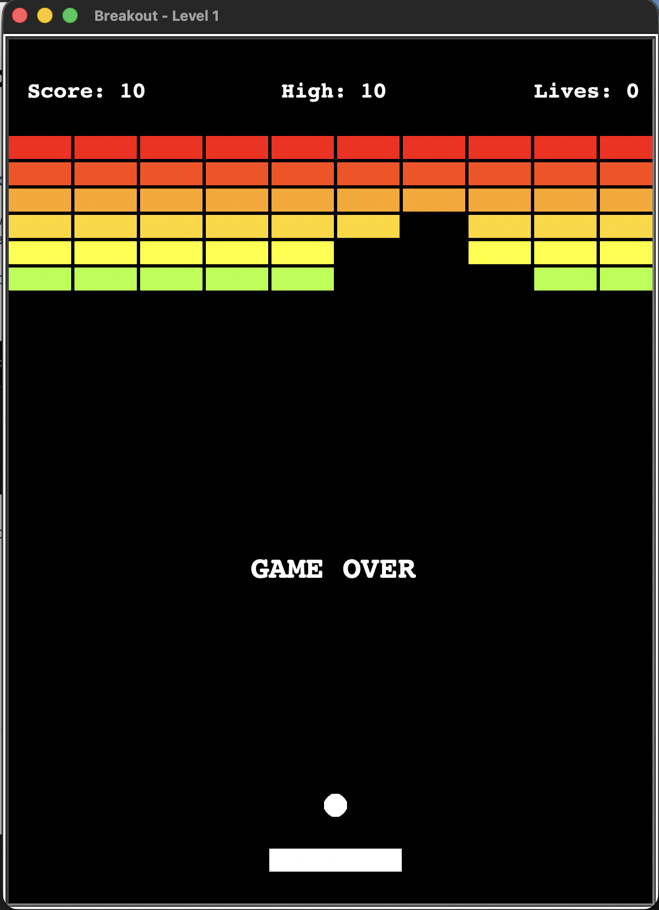

# Breakout

A classic Breakout arcade game built with Python and the `turtle` module, as part of my 100 Days of Code journey (Day 87).



## Features

- Paddle controlled with the arrow keys; the ball bounces at different angles depending on where it hits the paddle
- 6 rows × 10 columns of colored bricks, with higher rows worth more points
- Score, lives (3) and a persistent high score saved to a file
- 3 levels, with the ball getting faster on each level and as the rally goes on
- Start / pause with the space bar
- Sound effects (macOS system sounds)

## Controls

| Key | Action |
| --- | --- |
| `←` / `→` | Move the paddle |
| `Space` | Start / pause |

## Run it

Requires Python 3 with Tkinter (included in most Python installations).

```bash
git clone <repo-url>
cd Day_87
python3 main.py
```

Sound effects use `afplay` and work on macOS only; on other systems the game runs silently.

## Project structure

```
├── main.py        # screen setup, game loop, collisions, levels
├── paddle.py      # Paddle class
├── ball.py        # Ball class: movement, bounces, speed
├── bricks.py      # Brick and Bricks classes: wall layout and collision check
├── scoreboard.py  # score, lives, high score, on-screen messages
└── sounds.py      # sound effects helper
```

## What I learned

- Planning a project first: spec, checklist and flowchart before writing code
- Splitting a game into small classes with a single responsibility
- Collision detection with rectangles, including choosing the bounce axis by penetration depth
- Managing game state (running, paused, levels) in a `turtle` game loop
